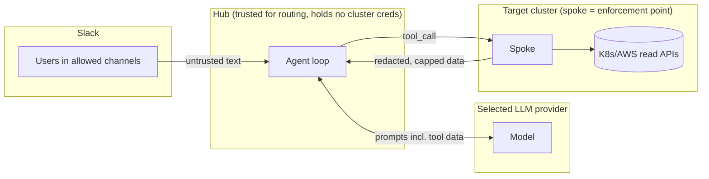

# Security

**Audience:** operators, contributors and security reviewers.

## Trust boundaries

| Boundary | What crosses | Controls |
| --- | --- | --- |
| Slack → hub | User question (untrusted) | Channel allowlist, per-user rate limit, question length cap |
| Hub ↔ selected LLM | System prompt, history, tool results (untrusted content) | API key over HTTPS for the configured endpoint or IAM for Bedrock; token/response/time caps; secrets redacted before the hub; no authorization-bearing redirects |
| Hub → spoke | Tool name + args, chosen by the LLM (untrusted) | Spoke-side schema validation, namespace policy, read-only RBAC/IAM, per-tool limits |
| Spoke → hub | Cluster data | Field projection, redaction, size caps; WSS over TLS; token auth |
| Hub → Slack | Answer text (LLM-generated) | Unfurls disabled; max length; environment/feedback footer; tool metadata retained in audit records |

## Threats and mitigations

| # | Threat | Mitigation | Residual risk |
| --- | --- | --- | --- |
| T1 | **Write action via the bot** (prompt or bug) | No write tools; spoke has no write code paths; RBAC/IAM read-only (ADR-006) | None in v1 |
| T2 | **Secret disclosure** via Secret objects, ConfigMaps, env values, or Helm values | Secrets/ConfigMaps not in RBAC; `env[].value` stripped; probe headers/exec commands omitted; Argo source/spec fields never returned | Secrets printed **in logs** are only caught by redaction patterns (T3) |
| T3 | **Secrets in container logs** | Spoke-side redaction (list below); log tail and byte caps; logs only from allowlisted namespaces | Unknown secret formats can slip through. Report and add a pattern |
| T4 | **Indirect prompt injection** through logs, events, annotations, or image names | Tool output is wrapped as data and the system prompt marks it untrusted; no write tools; unfurls disabled; namespace policy enforced in code, not prompt; per-turn tool-call cap | Model can be steered into a misleading answer. Users can request detailed evidence; audit records retain tool names, arguments, outcomes and timing. A friendly summary is not a factuality guarantee |
| T5 | **Cross-scope reads** (denied namespace, unmapped cluster) | Hub checks channel → cluster; spoke checks namespace allow/deny on every tool, including label-selector and "all namespaces" paths | Policy bug. Contract tests cover every tool × denied namespace |
| T6 | **Rogue or impersonated spoke** feeding false data | Per-spoke bearer token (≥ 256-bit random, stored hashed in hub); `cluster_id` bound to token; TLS | Stolen spoke token. Rotate per runbook; add mTLS in Phase 3 if required |
| T7 | **Hub compromise** | Hub has no cluster credentials; spokes validate everything; provider credentials scoped to model access | Attacker can read data that spokes would serve |
| T8 | **Abuse / cost blow-up** | Per-user/global limits, max iterations, token and response caps; provider-specific cost monitoring for deployment | — |
| T9 | **Provider data handling / residency** | Operators select and approve provider retention, upstream routing and regional processing for their cluster data | Provider data handling is deployment-specific |
| T10 | **Laptop spoke credential misuse** (Phase 1) | Dedicated read-only role, not the developer's admin session (ADR-009); short-lived SSO-derived creds | Developer laptop compromise. Same exposure as the developer's own access, but read-only |

## Redaction (spoke-side)

`redact(text) -> (text, count)` runs on every string field of every tool result before serialization. Each match is replaced with `[REDACTED:<kind>]`.

| Kind | Pattern (intent) |
| --- | --- |
| `jwt` | `eyJ[A-Za-z0-9_-]+\.[A-Za-z0-9_-]+\.[A-Za-z0-9_-]+` |
| `bearer` | `(?i)(authorization|bearer)\s*[:=]?\s*\S+` |
| `aws_access_key` | `\b(AKIA|ASIA)[A-Z0-9]{16}\b` |
| `aws_secret` | `(?i)aws.{0,20}secret.{0,20}[:=]\s*\S{30,}` |
| `kv_secret` | `(?i)\b(password|passwd|pwd|secret|token|api[_-]?key|client[_-]?secret)\b\s*[:=]\s*("[^"]*"|'[^']*'|\S+)` |
| `conn_string` | `\b[a-z][a-z0-9+.-]*://[^\s:/@]+:[^\s@]+@` (credentials in URLs) |
| `private_key` | `-----BEGIN [A-Z ]*PRIVATE KEY-----` through `END` |
| `pan` | 13–19 digit runs, optionally separated by space or hyphen, **that pass the Luhn check** |
| `slack_token` | `xox[abprs]-[A-Za-z0-9-]+`, `xapp-[A-Za-z0-9-]+` |
| `github_token` | `gh[pousr]_[A-Za-z0-9]{36,}`, `github_pat_[A-Za-z0-9_]{50,}` |

Rules:
- Redaction runs **after** field projection and **before** truncation, so a cut can never split a secret and leave part of it unredacted.
- The count of redactions per result is returned (`redactions`) and logged. The redacted values are never logged.
- New patterns need a positive and a negative test case in `tests/unit/test_redact.py`.

## Audit

The hub writes one structured audit record per question. It holds the Slack user ID, channel ID, thread ts, question text (redacted with the same function), clusters touched, each tool call (name, args, ok/error code, duration, redaction count, bytes), Bedrock token usage, total duration, and outcome.

- Tool **result payloads are not logged**.
- Retention: Phase 0–2 uses stdout logs only, with cluster log retention. Before Phase 3, decide the sink, access group, and an explicit retention end date.

## Secrets used by pro-pilot itself

| Secret | Phase 0–1 | Phase 2+ |
| --- | --- | --- |
| Slack bot token `xoxb-`, app token `xapp-` | `.env` (git-ignored) | Existing Secret or manual Helm-managed Secret from private/SOPS-encrypted values; no Argo CD dependency |
| Spoke token | `.env` on both sides (dev token) | Hub: SHA-256 hashes in a Secret. Spoke: plaintext in a Secret in the target cluster |
| `PRO_PILOT_LLM_API_KEY` | Operator-owned `.env`, explicitly loaded by the launcher; never printed or committed | Managed Secret storage and deployment-specific provider approval are prerequisites |
| AWS credentials | SSO session (`aws sso login`) | EKS Pod Identity; no static keys |

Provider choice and data processing regions are operator decisions. Inspect
redacted output and scope before enabling real-cluster questions.

Spoke-token rotation: the hub accepts two hashes per cluster (`current`, `next`) during a rotation window.
